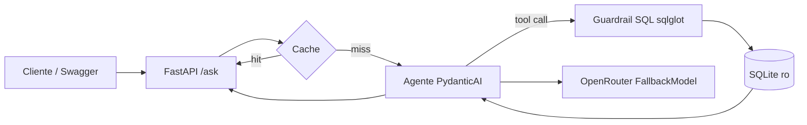

# Arquitetura e regras de negócio

[Voltar ao README](../README.md)

### Sumário
- [Fluxo](#fluxo)
- [Camadas](#camadas)
- [Decisões](#decisões)
- [Regras de negócio](#regras-de-negócio)

# Fluxo

# Camadas

As dependências vão sempre de `app/api` para `app/agent` e de `app/agent` para
`app/db`. Nenhuma camada de baixo importa de uma de cima.

**`app/db` — acesso ao banco.** Cada consulta abre uma conexão nova em
`mode=ro`, com `PRAGMA query_only=ON` e `ATTACH` bloqueado
(`SQLITE_LIMIT_ATTACHED=0`). O guardrail (`guardrails.py`) valida o SQL com
`sqlglot` e devolve a consulta já reescrita a partir da árvore validada: o que
roda é exatamente o que foi checado. `connection.py` aplica o tempo máximo com
`set_progress_handler` e lê `SQL_MAX_ROWS + 1` linhas para saber se houve
corte. Esta camada não sabe nada de LLM nem de HTTP.

**`app/agent` — LLM, prompt e cache.** `prompts.py` monta o prompt de sistema
com o esquema e as regras. `llm.py` cria a cadeia de modelos e consulta a cota.
`agent.py` define o agente e a ferramenta `run_sql`. `cache.py` guarda as
respostas, e `service.py` junta cache, agente, log e latência. Esta camada não
conhece HTTP.

**`app/api` — HTTP.** `routes.py` só traduz cada rota para a camada de baixo,
sem SQL nem chamada direta ao LLM. `schemas.py` define os modelos de entrada e
saída e os exemplos do Swagger. `errors.py` converte as exceções de domínio em
status HTTP. `main.py` monta o app e, no `lifespan`, carrega a configuração,
confere o banco e constrói o agente uma única vez.

# Decisões

**PydanticAI.** Usa os mesmos modelos Pydantic do FastAPI, faz tool calling e
fala com qualquer API no padrão OpenAI, como o OpenRouter. Já traz
`FallbackModel` para trocar de modelo e `FunctionModel` para testar o agente sem
gastar cota. Para um agente com uma única ferramenta, LangGraph seria peso
desnecessário.

**Orçamento de chamadas.** A cota grátis é de 50 chamadas por dia, e falhas
também contam. Por isso o esquema e as regras vão fixos no prompt, sem
ferramenta para listar tabelas (que custaria uma chamada a mais por pergunta).
O alvo é 2 chamadas por pergunta, com teto em `AGENT_REQUEST_LIMIT`.

**Defesa em camadas no SQL.** Nenhuma barreira basta sozinha: banco somente
leitura, `query_only`, `ATTACH` bloqueado, uma única instrução
`SELECT`/`UNION`, lista fechada das 10 tabelas da Gold (`sqlite_master`,
`alembic_version` e funções como `pragma_table_info` ficam de fora), `LIMIT`
imposto e tempo máximo por consulta. Quando o SQL não tem `LIMIT`, o guardrail
impõe `SQL_MAX_ROWS + 1`: a linha extra é o que permite marcar `truncated`.

**Fallback e o 429.** Os modelos de `LLM_MODELS` são encadeados em
`FallbackModel`. Um 429 de provedor lotado (`upstream`), um 5xx ou uma falha de
conexão passam para o próximo modelo. Um 429 sem `upstream` é cota diária
esgotada: a cadeia para e a API responde 429 com o horário de reset. O cliente
OpenAI roda com `max_retries=0`, porque o SDK repetiria a chamada sozinho e
cada falha consome cota.

**Cache.** A chave é `sha256(pergunta normalizada + modelos na ordem + versão
do prompt)`. Normalizar é passar para minúsculas, tirar acentos e colapsar
espaços. Mudar o prompt muda a versão e invalida o cache. Erros não são
guardados.

# Regras de negócio

Cada regra vem de um achado no banco e está escrita no prompt de sistema.

- "Receita" = "Faturamento" = "Bilheteria" = colunas `receita_*`. A moeda
  padrão é USD; "R$" ou "reais" usa as colunas `_brl`, que já vêm convertidas
  com o câmbio de cada filme.
- `receita_usd` é NULL em 92.272 de 95.645 filmes, e `lucro_*` nunca é NULL
  (sem receita, vira `-orçamento` ou 0). Por isso lucro e margem só valem com
  `receita_usd IS NOT NULL`.
- **Margem** = `lucro_usd * 1.0 / receita_usd`, exigindo também
  `orcamento_usd > 0`. É uma escolha de projeto, e o agente declara a fórmula
  nas `assumptions`. O `* 1.0` é necessário porque os valores monetários são
  inteiros no SQLite, e a divisão inteira daria 0.
- Nota TMDB exige `qtd_tmdb > 0` (`nota_tmdb = 0` com `qtd_tmdb = 0` significa
  sem votos). Nota IMDb exige `nota_imdb IS NOT NULL`. Todas as notas vão de 0 a
  10 e podem ser comparadas sem normalizar.
- "Nota" sem qualificação (por exemplo, "diretores com maior nota média")
  significa `nota_imdb`.
- "Últimos N anos" = `ano_lancamento >= CAST(strftime('%Y','now') AS INT) - N
  AND status_filme = 'Lançado'`. O banco tem filmes de 2016 a 2029, inclusive
  ainda não lançados.
- Dupla ator–diretor: a mesma pessoa pode estar em `dim_people` como Ator e
  como Diretor, com ids diferentes. A consulta junta por `tipo_pessoa` no mesmo
  `sk_movie_id` e exclui `nome_ator = nome_diretor`. "Mínimo de N filmes" =
  `HAVING COUNT(DISTINCT sk_movie_id) >= N`.
- "Mais avaliados" usa `dim_reviews.qtd_avaliacoes_usuarios`, e a nota dos
  usuários é `dim_reviews.nota_media_usuarios`. `movie_reviews` guarda o texto
  de cada avaliação.
- Os gêneros estão em inglês (19 valores) e os status em português. O prompt
  traz a tradução PT→EN dos gêneros e os valores exatos de status.
- As respostas sempre trazem `titulo` ou o nome, nunca só os ids `sk_*`.
